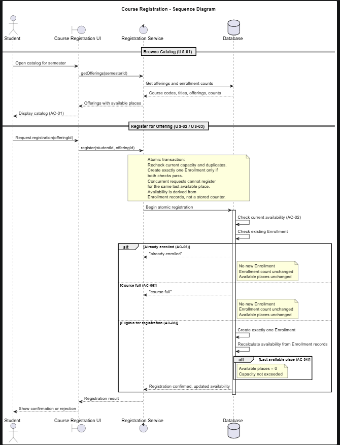
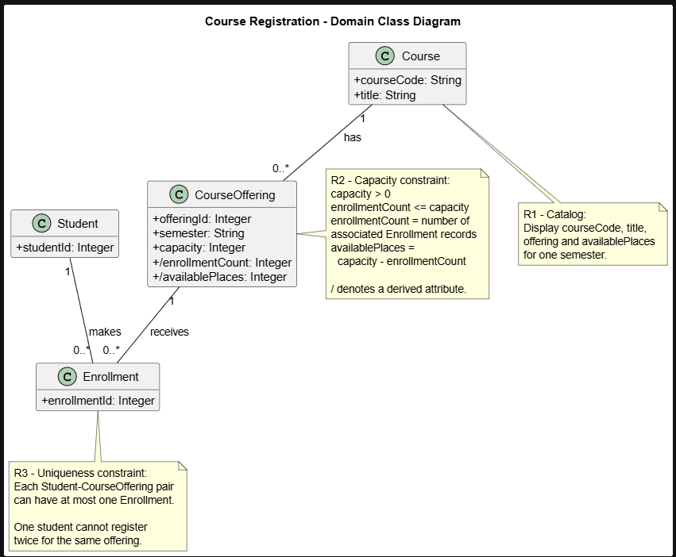
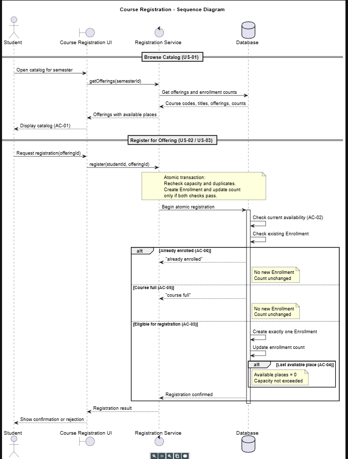
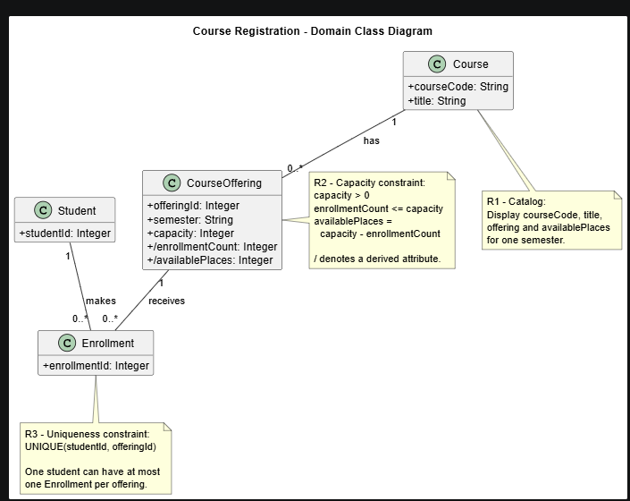

# SIS #02 — AI-Assisted UML Modeling: University Course Registration

<!--
  This is the only file you write your report in. README.md tells you what goes where.

  Rules the checker relies on:
  - Do not delete, rename or renumber the ## headings, the ### headings, or the **Label:** words.
  - Replace every "(write here)" and "(paste here)". None may be left when you submit.
  - Comments like this one are ignored by the checker and the word counter. Delete them or leave them.
-->

## 1. Scope and assumptions

<!-- Your FINAL scope statement and assumptions, after reviewing Prompt A's output. Say here
     what is out of scope (payments, prerequisites, timetable clashes, waiting lists,
     cancellation) — section 2 must not mention them. Section 10 keeps your first version. -->

**Scope:** (write here)

**Assumptions:**

1. (write here)
2. (write here)

## 2. User stories and acceptance criteria

<!-- Your APPROVED requirements: Prompt A's draft after your review. Keep the IDs, the three
     story headings and the bullet shape. Every criterion names the rule(s) it maps to,
     e.g. (R2, R4). Two criteria per story. Nothing out of scope.
     Format of a criterion, on one bullet:
     - **AC-03** (R2, R4): Given ..., When ..., Then ... -->

### US-01 — Browse offerings

**US-01:** As a student, I want to view available course offerings for one semester, so that I can select an offering for registration.

- **AC-01** (R1): Given the student is signed in and course offerings exist for the semester, When the student opens the course catalog, Then the system displays each course code, title, offering, and number of available places.
- **AC-02** (R1,R2): Given the student has viewed the catalog and the available places may have changed, When the student selects an offering and requests registration, Then the system checks current availability instead of treating the catalog information as a reserved place.

### US-02 — Register for an offering

**US-02:** As a student, I want to register for a course offering with available places, so that my enrollment is recorded and confirmed.

- **AC-03** (R2, R3, R4): Given the selected offering has available places and the student is not already enrolled, When the student submits a registration request, Then the system atomically checks capacity and duplicates, creates exactly one Enrollment linking the student and offering, updates availability, and returns a confirmation
- **AC-04** (R2, R4): Given the selected offering has exactly one available place and the student is not already enrolled, When the student submits a registration request, Then the system creates exactly one Enrollment, fills the last place, updates availability to zero, and confirms registration without exceeding capacity

### US-03 — Receive a clear rejection

**US-03:** As a student, I want to receive a clear explanation when registration fails, so that I understand why my request was rejected.

- **AC-05** (R2, R5): Given the selected offering is full, When a student who is not already enrolled requests registration, Then the system returns "course full", creates no Enrollment, and leaves the enrollment count unchanged.
- **AC-06** (R3, R5): Given the student is already enrolled in the selected offering, When the student submits another registration request for the same offering, Then the system returns "already enrolled", creates no additional Enrollment, and leaves the enrollment count unchanged.

## 3. Sequence diagram

<!-- The FINAL diagram, rendered. Change .png to .svg if that is what you exported. -->



**Participants:** (write here — each lifeline and what it stands for)

**Atomic operation:** (write here — which messages form the one atomic step: the final duplicate check, the capacity check and the creation of the Enrollment, and why a catalog view reserves nothing)

**Where the Enrollment is created:** (write here — which message, which lifeline, and which class in section 4 it produces)

**Technical lifelines:** (write here — every lifeline that is NOT a class in the class diagram, by name, and why the difference in abstraction is fine. "None" if there are none.)

## 4. Class diagram

<!-- The FINAL diagram, rendered. -->



<!-- One row per association in classes.puml, read in both directions. -->

| Association | Read left to right | Read right to left |
| --- | --- | --- |
| (write here) | (write here) | (write here) |
| (write here) | (write here) | (write here) |
| (write here) | (write here) | (write here) |

**How an Enrollment links a student to an offering:** (write here)

**Capacity constraint:** (write here — and why multiplicity alone cannot express it)

**Uniqueness constraint:** (write here — and why multiplicity alone cannot express it)

## 5. Traceability

<!-- Every rule, including the catalog fields and availability (R1). Column 1: the rule and
     the criteria that cover it, e.g. "R2 + AC-03, AC-04". Column 2: the message, guard,
     class or constraint that shows the rule in YOUR diagrams. Column 3: the T-ID that
     exercises it, or the extra check you did instead (R1 has no T case). -->

| Rule and criterion | Model evidence | Validation case |
| --- | --- | --- |
| R1 + (write here) | (write here) | (write here) |
| R2 + (write here) | (write here) | (write here) |
| R3 + (write here) | (write here) | (write here) |
| R4 + (write here) | (write here) | (write here) |
| R5 + (write here) | (write here) | (write here) |

## 6. Walkthroughs

<!-- Walk each case through YOUR final sequence diagram, message by message. Column 2: the
     actual steps and the state change (count before → after). Column 3 starts with Pass or
     Fail, then the location: the message, guard or note where you saw it. A Fail you
     report honestly is a finding, not a penalty. -->

| Case | Observed path and state change | Judgment and evidence |
| --- | --- | --- |
| T1. Available | (write here) | (write here) |
| T2. Last place | (write here) | (write here) |
| T3. Full | (write here) | (write here) |
| T4. Duplicate | (write here) | (write here) |

## 7. Review decisions

<!-- At least three substantive decisions about Prompt C's critique or your own inspection.
     Decision: accepted / rejected / modified — and what you did. Reason: why, in a full
     sentence. Rule: R1–R5. Do not invent an error to fill the table; a justified rejection
     of advice counts. -->

| AI suggestion or model element | Decision | Reason | Rule |
| --- | --- | --- | --- |
| (write here) | (write here) | (write here) | (write here) |
| (write here) | (write here) | (write here) | (write here) |
| (write here) | (write here) | (write here) | (write here) |

## 8. Modeling explanation

<!-- 200–300 words. Your main design choices; how the class diagram and the sequence diagram
     complement each other; why an activity diagram could also help explain the workflow. -->

(write here)

## 9. Reflection

<!-- 150–200 words. Written by you, not by the assistant: where AI helped, one decision you
     made yourself, one remaining limitation. Specific beats flattering. -->

(write here)

## 10. Appendix A — Before AI

<!-- Written BEFORE you run Prompt A, committed and pushed in your first commit, and never
     edited afterwards. This is what you paste into Prompt A as "My initial assumptions". -->

**Scope:** The system allows students to view available courses and register for a specific course offering. It checks the number of available places and prevents duplicate registrations. If registration is successful, the system creates one enrollment and sends a confirmation. If registration is rejected, it explains the reason without changing enrollment data

**Initial assumptions:**

1. The student is already signed in, and the selected course offering exists in the system
2. Every course offering has a positive capacity, and the number of enrollments cannot exceed this limit
3. The available places shown in the catalogs that may change before registration, so the system checks availability again when the studentt submits a requests 

## 11. Appendix B — AI exchanges

<!-- Complete prompts and complete responses, as text — never screenshots. Paste each inside
     the ~~~~ block that follows its label: AI responses contain ``` PlantUML blocks, and
     ~~~~ keeps them from breaking this file. Prompts B and C: the prompt text first, then
     the material it refers to ("below", "these two") pasted under it, in the same block.
     You may add B5, B6 … after B4 if you ran more. -->

### B1 — Requirements (Prompt A)

- **Tool:** ChatGPT
- **Model:** GPT-6 Astra
- **Date:** 18.10.2026
- **Purpose:** draft 3 user stories and 6 acceptance criteria

<!-- Model: the exact model with its version, as the tool shows it (e.g. "GPT-5 Thinking",
     "Claude Sonnet 4.5"). If the tool does not show it, write: not displayed
     Date: YYYY-MM-DD -->

**Prompt:**

~~~~text
Act as a requirements analyst. Use only this course registration scenario and rules R1–R5: **\*\*R1. Catalog\*\*** | Show the course code, title, offering and available places for one semester. |
\| **\*\*R2. Capacity\*\*** | Recheck current availability when registering. Enrollment must never exceed the offering's capacity. |
\| **\*\*R3. Duplicates\*\*** | A student may have at most one enrollment in the same offering. Reject a repeat request. |
\| **\*\*R4. Success\*\*** | Create exactly one Enrollment linking the student and offering, update availability and return a confirmation. |
\| **\*\*R5. Rejection\*\*** | Explain "course full" or "already enrolled". Create no enrollment and leave the enrollment count unchanged. |. My initial assumptions are 1. The student is already signed in, and the selected course offering exists in the system\
2\. Every course offering has a positive capacity, and the number of enrollments cannot exceed this limit\
3\. The available places shown in the catalogs that may change before registration, so the system checks availability again when the studentt submits a requests \
Draft 3 user stories and 2 Given / When / Then acceptance criteria for each. Use IDs US-01 to US-03 and AC-01 to AC-06. Map each criterion to rule IDs.\
Cover normal and rejection behavior. List uncertainty separately. Do not add excluded features or invent university policies.
~~~~

**Response:**

~~~~text
## 1. User Stories

### US-01 — View Course Catalog

As a student, I want to view course offerings and available places for one semester, So that I can choose a course offering for registration.

AC-01 — Display Course Information (R1)

- Given the student is signed in and course offerings exist for the selected semester,
- When the student opens the course catalog,
- Then the system displays each offering's course code, title, offering, and available places.

AC-02 — Display Updated Availability (R1, R2)

- Given the student has viewed the catalog and the available places have changed,
- When the student submits a registration request,
- Then the system rechecks the current availability instead of relying on the previously displayed number.

### US-02 — Register for a Course

As a student, I want to register for a course offering with available places, So that my enrollment is recorded successfully.

AC-03 — Successful Registration (R2, R3, R4)

- Given the student is signed in, the selected offering has available places, and the student is not already enrolled,
- When the student submits a registration request,
- Then the system creates exactly one Enrollment linking the student and offering, updates availability, and returns a confirmation.

AC-04 — Prevent Exceeding Capacity (R2, R5)

- Given the selected offering has no available places,
- When the student submits a registration request,
- Then the system rejects the request with "course full", creates no Enrollment, and leaves the enrollment count unchanged.

### US-03 — Prevent Duplicate Enrollment

As a student, I want to be prevented from registering twice for the same course offering, So that my enrollment records do not contain duplicates.

AC-05 — Reject Duplicate Registration (R3, R5)

- Given the student already has an Enrollment for the selected offering,
- When the student submits another registration request for the same offering,
- Then the system rejects the request with "already enrolled", creates no additional Enrollment, and leaves the enrollment count unchanged.

AC-06 — Allow Registration for a Different Offering (R2, R3, R4)

- Given the student is enrolled in one offering but is not enrolled in another offering that has available places,
- When the student submits a registration request for the other offering,
- Then the system creates exactly one new Enrollment for that offering, updates its availability, and returns a confirmation.

## 2. Requirements Traceability Matrix

| Criterion | Rule IDs   | Behavior                      |
| --------- | ---------- | ----------------------------- |
| AC-01     | R1         | Display catalog               |
| AC-02     | R1, R2     | Recheck availability          |
| AC-03     | R2, R3, R4 | Successful registration       |
| AC-04     | R2, R5     | Reject full course            |
| AC-05     | R3, R5     | Reject duplicate              |
| AC-06     | R2, R3, R4 | Register for another offering |

All five rules (R1–R5) are covered.

## 3. Initial Assumptions

1. The student is already signed in, and the selected course offering exists in the system.
2. Every course offering has a positive capacity, and the enrollment count cannot exceed that capacity.
3. Available places shown in the catalog may change before registration, so the system rechecks availability when the student submits a request.

## 4. Uncertainties

1. Semester selection: It is unclear whether the semester is predefined or selected by the student.
2. Simultaneous requests: The rules do not specify how the system handles multiple students registering for the last available place at the same time.
3. Conflicting rejection conditions: If an offering is full and the student is already enrolled, it is unclear which rejection message takes priority.
4. Availability updates: The rules do not specify whether the catalog updates automatically or only when reopened.

These uncertainties require clarification and are not treated as additional requirements.
~~~~

### B2 — UML drafts (Prompt B)


- **Tool:** ChatGPT
- **Model:** GPT-6 Astra
- **Date:** 18.10.2026
- **Purpose:** draft the sequence and class diagrams

**Prompt:**

~~~~text
Using my approved scenario, R1–R5, stories and criteria below, return separate PlantUML code blocks for a sequence diagram and a domain class diagram.\
Sequence: include catalog browsing and guarded success, full-course and duplicate outcomes. Model final checks and creation as one atomic operation.\
Class: show domain concepts, useful attributes and multiplicities. State the capacity and uniqueness constraints. Explain assumptions and any technical lifelines.**### US-01 — Browse offerings**

**\*\*US-01:\*\*** As a student, I want to view available course offerings for one semester, so that I can select an offering for registration.

\- **\*\*AC-01\*\*** (R1): Given the student is signed in and course offerings exist for the semester, When the student opens the course catalog, Then the system displays each course code, title, offering, and number of available places.
\- **\*\*AC-02\*\*** (R1,R2): Given the student has viewed the catalog and the available places may have changed, When the student selects an offering and requests registration, Then the system checks current availability instead of treating the catalog information as a reserved place.

**### US-02 — Register for an offering**

**\*\*US-02:\*\*** As a student, I want to register for a course offering with available places, so that my enrollment is recorded and confirmed.

\- **\*\*AC-03\*\*** (R2, R3, R4): Given the selected offering has available places and the student is not already enrolled, When the student submits a registration request, Then the system atomically checks capacity and duplicates, creates exactly one Enrollment linking the student and offering, updates availability, and returns a confirmation
\- **\*\*AC-04\*\*** (R2, R4): Given the selected offering has exactly one available place and the student is not already enrolled, When the student submits a registration request, Then the system creates exactly one Enrollment, fills the last place, updates availability to zero, and confirms registration without exceeding capacity

**### US-03 — Receive a clear rejection**

**\*\*US-03:\*\*** As a student, I want to receive a clear explanation when registration fails, so that I understand why my request was rejected.

\- **\*\*AC-05\*\*** (R2, R5): Given the selected offering is full, When a student who is not already enrolled requests registration, Then the system returns "course full", creates no Enrollment, and leaves the enrollment count unchanged.
\- **\*\*AC-06\*\*** (R3, R5): Given the student is already enrolled in the selected offering, When the student submits another registration request for the same offering, Then the system returns "already enrolled", creates no additional Enrollment, and leaves the enrollment count unchanged.
~~~~

**Response:**

~~~~text
## 1. Sequence Diagram — PlantUML

This diagram covers catalog browsing (US-01), successful registration (US-02), and rejection cases (US-03). Registration checks and enrollment creation occur within one atomic transaction.

```

@startuml
title Course Registration - Sequence Diagram

actor Student
boundary "Course Registration UI" as UI
control "Registration Service" as Service
database "Database" as DB

== Browse Catalog (US-01) ==

Student -> UI: Open catalog for semester
UI -> Service: getOfferings(semesterId)
Service -> DB: Get offerings and enrollment counts
DB --> Service: Course codes, titles, offerings, counts
Service --> UI: Offerings with available places
UI --> Student: Display catalog (AC-01)

== Register for Offering (US-02 / US-03) ==

Student -> UI: Request registration(offeringId)
UI -> Service: register(studentId, offeringId)

note over Service, DB
Atomic transaction:
Recheck capacity and duplicates.
Create Enrollment and update count
only if both checks pass.
end note

Service -> DB: Begin atomic registration
activate DB

DB -> DB: Check current availability (AC-02)
DB -> DB: Check existing Enrollment

alt Already enrolled (AC-06)
    DB --> Service: "already enrolled"
    note right of DB
    No new Enrollment
    Count unchanged
    end note

else Course full (AC-05)
    DB --> Service: "course full"
    note right of DB
    No new Enrollment
    Count unchanged
    end note

else Eligible for registration (AC-03)
    DB -> DB: Create exactly one Enrollment
    DB -> DB: Update enrollment count

    alt Last available place (AC-04)
        note right of DB
        Available places = 0
        Capacity not exceeded
        end note
    end

    DB --> Service: Registration confirmed
end

deactivate DB

Service --> UI: Registration result
UI --> Student: Show confirmation or rejection

@enduml

```

Rule coverage: R1–R5, AC-01–AC-06.

The database operation is atomic: concurrent requests cannot both take the last available place, provided the capacity and uniqueness checks are enforced within the same transaction. The diagram shows duplicate rejection before capacity rejection; this ordering is a modeling assumption, not an additional university policy.

## 2. Domain Class Diagram — PlantUML

The diagram contains four domain classes: Student, Course, CourseOffering, and Enrollment.

```

@startuml
title Course Registration - Domain Class Diagram

skinparam classAttributeIconSize 0
hide empty methods

class Student {
    +studentId: Integer
}

class Course {
    +courseCode: String
    +title: String
}

class CourseOffering {
    +offeringId: Integer
    +semester: String
    +capacity: Integer
    +/enrollmentCount: Integer
    +/availablePlaces: Integer
}

class Enrollment {
    +enrollmentId: Integer
}

Course "1" -- "0..*" CourseOffering : has
Student "1" -- "0..*" Enrollment : makes
CourseOffering "1" -- "0..*" Enrollment : receives

note right of CourseOffering
R2 - Capacity constraint:
capacity > 0
enrollmentCount <= capacity
availablePlaces =
  capacity - enrollmentCount

/ denotes a derived attribute.
end note

note bottom of Enrollment
R3 - Uniqueness constraint:
UNIQUE(studentId, offeringId)

One student can have at most
one Enrollment per offering.
end note

note bottom of Course
R1 - Catalog:
Display courseCode, title,
offering and availablePlaces
for one semester.
end note

@enduml

```

### Multiplicities

| Relationship                | Multiplicity | Meaning                                      |
| --------------------------- | ------------ | -------------------------------------------- |
| Course → CourseOffering     | 1 to 0..\*   | A course can have multiple offerings         |
| Student → Enrollment        | 1 to 0..\*   | A student can have multiple enrollments      |
| CourseOffering → Enrollment | 1 to 0..\*   | An offering can contain multiple enrollments |
| Enrollment → Student        | 1 to 1       | Each enrollment belongs to one student       |
| Enrollment → CourseOffering | 1 to 1       | Each enrollment refers to one offering       |

## 3. Constraints

Capacity constraint (R2)

\\[ 0 \leq enrollmentCount \leq capacity \\]

\\[ availablePlaces = capacity - enrollmentCount \\]

Registration must never increase `enrollmentCount` beyond `capacity`.

Uniqueness constraint (R3)

```
UNIQUE(student_id, offering_id)
```

A student cannot register twice for the same course offering.

Atomic registration (R2–R5)

Capacity validation, duplicate validation, Enrollment creation, and count updates must occur as one atomic operation. Rejected operations leave the enrollment count unchanged.

## 4. Assumptions and Technical Lifelines

Assumptions

1. The student is already authenticated.
2. The selected course offering exists.
3. Course offerings have positive capacity.
4. Available places are calculated using current enrollment data.
5. Duplicate requests are checked before full-course rejection when both conditions apply.

Technical lifelines (sequence diagram)

| Lifeline               | Purpose                                                 |
| ---------------------- | ------------------------------------------------------- |
| Student                | Initiates browsing and registration                     |
| Course Registration UI | Displays offerings and registration results             |
| Registration Service   | Coordinates catalog and registration requests           |
| Database               | Stores domain entities and enforces atomic registration |

The UI, Registration Service, and Database are technical components, not additional domain classes. No payment, prerequisites, waitlists, approval process, or other university policies have been introduced.

Both diagrams are aligned with US-01–US-03, AC-01–AC-06, and R1–R5.
~~~~

### B3 — Model critique (Prompt C)

- **Tool:** (write here)
- **Model:** (write here)
- **Date:** (write here)
- **Purpose:** review both models against R1–R5 and T1–T4

**Prompt:**

~~~~text
(paste here)
~~~~

**Response:**

~~~~text
(paste here)
~~~~

### B4 — Focused revision (Prompt D)

- **Tool:** (write here)
- **Model:** (write here)
- **Date:** (write here)
- **Purpose:** apply my accepted review decisions

**Prompt:**

~~~~text
(paste here)
~~~~

**Response:**

~~~~text
(paste here)
~~~~

## 12. Appendix C — Original diagrams

<!-- The AI's first output from Prompt B, rendered unedited from models/original/. -->





## 13. Appendix D — References and source checks

### References

<!-- Full references, one per line, each starting with "- ". Only sources you actually opened.
     Every URL used in the source checks must also appear here. Example:
     - Sommerville, I. (2016). Software Engineering, 10th ed., Global Edition. Pearson. Ch. 5. -->

- (write here)

### Source checks

<!-- At least two modeling decisions you verified. Source and locator: title + slide, page,
     section, chapter or figure — or title + URL + access date (YYYY-MM-DD). Slide numbers
     refer to the decks posted in our Teams. -->

| Modeling decision | Source and locator | What the source says | How it supports or changed your model |
| --- | --- | --- | --- |
| (write here) | (write here) | (write here) | (write here) |
| (write here) | (write here) | (write here) | (write here) |
