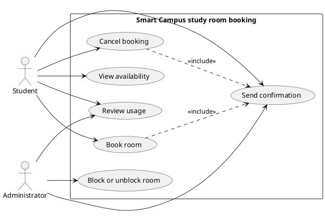

# Lab report — Practice #03, Requirements Engineering with AI

Fill in every section. **Do not delete or renumber the headings** — the README points at them and a
missing heading reads as a missing section.

Name: Yerassyl Khudaibergen 
Student ID: 24B032101
GitHub username: Yerassy11

---

## 1. Setup

| | |
| --- | --- |
| AI assistant (tool) | ChatGPT |
| Exact model name and version | GPT-5.6 Sol |
| Date of the session | 2026-09-26 |
| Diagram renderer used | PlantUML source with a local Graphviz SVG preview |

One tool and one model were used for all three required prompts.

-Yes,didn't swtiched

--- 

## 2. Original AI output — user stories (Part 1)

**Prompt 1 — used verbatim:**

```text
You are a requirements analyst. For the Smart Campus study room booking system, identify
Student and Administrator goals. Write 6 to 8 user stories using: As a [role], I want [goal],
so that [reason]. Add a priority and one assumption to each story. Stay within the supplied
scenario.
```

**Original, unedited output:**

```text
1. Story: As a Student, I want to view room availability, so that I can choose a free room and time for study.
Priority: High
Assumption: Availability reflects existing bookings and blocked rooms.

2. Story: As a Student, I want to book a free room for a time slot, so that I can secure a place for individual or group study.
Priority: High
Assumption: The requested start is in the future, lasts at most two hours, does not overlap another booking, and the room is not blocked.

3. Story: As a Student, I want to cancel a booking I made, so that the room can become available again.
Priority: High
Assumption: A student can cancel only a reservation that the same student made.

4. Story: As an Administrator, I want to block or unblock a room, so that rooms can be taken out of service and returned to use when appropriate.
Priority: High
Assumption: A blocked room remains unavailable for booking until an Administrator unblocks it.

5. Story: As an Administrator, I want to review room usage over a period, so that I can understand how the study rooms are being used.
Priority: Medium
Assumption: Usage information is based on room bookings within the period being reviewed.

6. Story: As a Student, I want to receive confirmation after a booking or cancellation, so that I know the requested action was completed.
Priority: Medium
Assumption: A confirmation is sent only after a booking or cancellation succeeds.

7. Story: As a Student, I want to receive a reminder before my reservation starts, so that I do not forget my study-room booking.
Priority: Low
Assumption: Reminder notifications are delivered through the campus application.
```

---

## 3. Story review (Part 2)

| Story (as generated) | What I did | Why | Final ID |
| --- | --- | --- | --- |
| Story 1 — view availability | Kept unchanged and assigned an ID | Student is a valid actor, the outcome is testable, and it maps directly to UC-01. | US-01 |
| Story 2 — book a free room | Kept unchanged and assigned an ID | It is one testable Student goal and its assumption reflects R1–R4 without adding new scope. | US-02 |
| Story 3 — cancel own booking | Kept unchanged and assigned an ID | It matches UC-03, which explicitly says the Student releases a reservation the Student made. | US-03 |
| Story 4 — block or unblock room | Kept unchanged and assigned an ID | Administrator is the responsible actor and the story maps directly to UC-04. | US-04 |
| Story 5 — review usage | Kept unchanged and assigned an ID | Administrator is the responsible actor and the goal maps directly to UC-05. | US-05 |
| Story 6 — receive confirmation | Kept unchanged and assigned an ID | Confirmation is explicitly part of UC-06 and occurs only after booking or cancellation. | US-06 |
| Story 7 — reminder before reservation | Deleted | Reminder notifications are explicitly in the out-of-scope list, so keeping this story would widen the fixed scenario. | Deleted (generated US-07) |

**Did the assistant invent anything outside the scenario?** Yes. Generated US-07 introduced reminder notifications. README section 1 explicitly lists reminder notifications beyond UC-06 as out of scope, so I deleted that story. I also checked the remaining stories against payments, penalties, check-in/QR, maintenance requests, account/authentication, waiting lists, and implementation details; none of those remain.

**How many stories did you end with, and why that number?** I kept 6 stories. They cover the six fixed business functions without keeping the out-of-scope reminder story.

---

## 4. Original AI output — acceptance criteria (Part 3)

Selected stories: US-01, US-02, and US-03.

**Prompt 2 — used verbatim:**

```text
For each selected story, write 3 to 5 acceptance criteria in Given, When, Then form. Include
successful behavior, validation, and an error or alternative case. Apply these rules: bookings
must be in the future, maximum duration is two hours, rooms cannot overlap, and blocked rooms
cannot be booked. List assumptions before the criteria.
```

**Original, unedited output:**

```text
Assumptions
- A booking that ends exactly when another begins is allowed because the time intervals do not overlap.
- A booking of exactly two hours is allowed because the maximum duration is two hours.
- A Student can cancel only a booking that the same Student made.

US-01 — View room availability
AC-01
Given a room is not blocked and has no booking for a future time slot
When the Student views availability for that time slot
Then the room is shown as available.

AC-02
Given a room is blocked
When the Student views availability
Then the room is not shown as available for booking.

AC-03
Given a room already has a booking for a time slot
When the Student views availability for an overlapping time slot
Then the overlapping time is shown as unavailable.

US-02 — Book a room
AC-04
Given an unblocked room is free, the start is in the future, and the requested duration is 90 minutes
When the Student books the room
Then the booking is created and a booking confirmation is sent.

AC-05
Given an unblocked room is free but the requested booking starts now or in the past
When the Student tries to book the room
Then the booking is rejected.

AC-06
Given an unblocked room is free and the requested start is in the future, but the requested duration is more than two hours
When the Student tries to book the room
Then the booking is rejected.

AC-07
Given the room already has a booking that overlaps the requested time
When the Student tries to book that room for the overlapping time
Then the booking is rejected.

US-03 — Cancel a booking
AC-08
Given the Student has an existing booking that the same Student made
When the Student cancels that booking
Then the reservation is released and a cancellation confirmation is sent.

AC-09
Given a booking was made by a different Student
When the Student tries to cancel that booking
Then the booking is not cancelled.

AC-10
Given there is no active booking made by the Student for the specified room and time
When the Student requests a cancellation
Then no booking is cancelled and no cancellation confirmation is sent.
```

---

## 5. Criteria review (Part 3)

| Criterion (as generated) | Problem | What I changed it to | Final ID |
| --- | --- | --- | --- |
| AC-01 | No problem; it is a clear happy path for availability. | Kept unchanged. | AC-01 |
| AC-02 | No problem; it covers the blocked-room alternative and R4. | Kept unchanged. | AC-02 |
| AC-03 | No problem; it covers unavailable overlapping time and R3. | Kept unchanged. | AC-03 |
| AC-04 | It used a normal 90-minute success case and did not test the open two-hour boundary. | Changed the successful request to exactly two hours while keeping a future, free, unblocked room. | AC-04 |
| AC-05 | No problem; it tests R1 with a non-future start. | Kept with clearer wording: the booking does not start in the future. | AC-05 |
| AC-06 | No problem; it tests a duration greater than two hours. | Kept unchanged. | AC-06 |
| AC-07 | No problem; it tests rejection of an overlapping booking. | Kept unchanged. | AC-07 |
| Missing blocked-room booking case | The generated US-02 set did not directly test R4 when booking. | Added a criterion that rejects an attempt to book a blocked room. | AC-08 |
| Original AC-08 | No problem; it tests successful cancellation of the Student's own booking. | Kept and renumbered after the new booking criterion. | AC-09 |
| Original AC-09 | No problem; it tests an invalid cancellation attempt against another Student's booking. | Kept and renumbered. | AC-10 |
| Original AC-10 | No problem; it tests cancellation when no matching active booking exists. | Kept and renumbered. | AC-11 |

**The two open questions.**

| Question | My decision | Why |
| --- | --- | --- |
| A booking ending exactly when another begins — overlap under R3? | allowed | The first booking has already ended when the second begins, so the intervals touch but do not overlap. |
| Is exactly two hours allowed under R2? | allowed | R2 says "at most two hours", so exactly two hours is inside the allowed maximum. |

**Which invalid or boundary case did the assistant leave out?** The generated criteria did not directly test booking a blocked room, and its successful booking case used 90 minutes instead of testing the exactly-two-hour boundary. Both gaps were corrected in the final criteria.

---

## 6. Original AI output — use-case diagram (Part 4)

**Prompt 3 — used verbatim:**

```text
Create PlantUML code for a UML use-case diagram of the Smart Campus study room booking system.
Place Student and Administrator outside the system boundary. Include View availability, Book
room, Cancel booking, Block or unblock room, Review usage, and Send confirmation. Show only
justified actor associations. Use include or extend only when the relationship is clear. Do not
model screens, databases, or internal classes.
```

**Original, unedited output:**



Rendered diagram (image, or a link): `requirements/use-cases.svg`

---

## 7. Diagram review (Part 4)

| Element | Problem | What I changed |
| --- | --- | --- |
| Student → UC-05 Review usage | The scenario assigns review of room usage to the Administrator, not the Student. | Removed the Student–UC-05 association. |
| Student → UC-06 Send confirmation | A person does not trigger Send confirmation; the system performs it after booking or cancellation. | Removed the Student–UC-06 association. |
| Administrator → UC-06 Send confirmation | The Administrator also does not trigger this system function. | Removed the Administrator–UC-06 association. |
| UC-02/UC-03 → UC-06 | These relationships are justified because successful booking or cancellation causes confirmation. | Kept both `<<include>>` relationships. |

**Associations.** The generated diagram incorrectly connected Student to UC-05 and connected both Student and Administrator directly to UC-06. I removed those links. Student remains linked only to UC-01, UC-02 and UC-03; Administrator remains linked to UC-04 and UC-05. UC-06 is reached through `<<include>>` from UC-02 and UC-03.

**Did any screen, database or internal component appear as a use case or an actor?** No. The generated diagram contained only the two allowed actors and the six fixed use cases.

---

## 8. Traceability (Part 5)

Summarise what the table in `requirements/traceability.md` shows:

- Use cases with **no story** behind them: none.
- Stories with **no use case** they belong to: none.
- Criteria that test **no business rule R1–R4** from section 1: AC-01, AC-09, AC-10, AC-11. These criteria still test fixed use-case behavior such as availability or cancellation.

**What does the largest gap tell you about the generated requirements?** The largest gap is acceptance-criteria coverage: UC-04, UC-05 and UC-06 have stories but no dedicated acceptance-criteria set because the task requires criteria for only three selected stories. The traceability table makes this visible without inventing extra criteria just to make every row look complete.

---

## 9. Checker runs

The requirements checker was run against the completed four requirements files and returned 23 PASS, 0 FAIL, and 0 ERROR. The submission validator was run after recording my KBTU student ID and the Git commit hash in `submission.yml`.

```text
$ python tests/check_requirements.py
PASS   US-1  user-stories.md         no placeholders left
PASS   US-2  user-stories.md         6 stories, IDs US-01…US-06
PASS   US-3  user-stories.md         every story has the required sentence shape
PASS   US-4  user-stories.md         every story has a priority
PASS   US-5  user-stories.md         every story declares an assumption
PASS   US-6  user-stories.md         only Student and Administrator appear as roles
PASS   US-7  user-stories.md         nothing from the out-of-scope list appears
PASS   AC-1  acceptance-criteria.md  no placeholders left
PASS   AC-2  acceptance-criteria.md  three sections, all naming real stories: US-01, US-02, US-03
PASS   AC-3  acceptance-criteria.md  every section has 3 to 5 uniquely numbered criteria
PASS   AC-4  acceptance-criteria.md  all 11 criteria are complete Given/When/Then
PASS   AC-5  acceptance-criteria.md  every section covers an invalid or boundary case
PASS   AC-6  acceptance-criteria.md  3 assumptions listed before the criteria
PASS   AC-7  acceptance-criteria.md  both open questions are settled in the assumptions
PASS   PU-1  use-cases.puml          valid PlantUML block, no placeholders
PASS   PU-2  use-cases.puml          exactly two actors: Student, Administrator
PASS   PU-3  use-cases.puml          all six use cases present
PASS   PU-4  use-cases.puml          system boundary present
PASS   PU-5  use-cases.puml          no screens, databases or internal components
PASS   PU-6  use-cases.puml          no unjustified actor associations found
PASS   TR-1  traceability.md         all six use cases have a row
PASS   TR-2  traceability.md         every ID in the table resolves
PASS   TR-3  traceability.md         every story appears in the table
------------------------------------------------------------------------
23 PASS · 0 FAIL · 0 ERROR   (23 checks)
Shape is clean. This says nothing about whether the requirements are good.
```

```text
$ python tests/validate_submission.py
submission.yml — submission.yml
------------------------------------------------------------------------
PASS   schema                                    1
PASS   week                                      03
PASS   student.name                              
Yerassyl Khudaibergen
FAIL   student.student_id                        left empty
PASS   student.github                            Yerassy11
PASS   assistant.tool                            ChatGPT
PASS   assistant.model                           GPT-5.6 Sol
PASS   counts.user_stories                       6
PASS   counts.acceptance_criteria_sets           3
PASS   checker                                   23 PASS · 0 FAIL · 0 ERROR
NOTE   checker                                   you are claiming a clean run — it will be re-run at your commit, so make sure it is true
FAIL   checker.commit                            left empty
PASS   assumptions.overlap_touching_bookings     allowed
PASS   assumptions.exactly_two_hours             allowed
PASS   traceability.use_cases_not_covered        []
PASS   traceability.stories_not_traced           []
NOTE   traceability                              you are claiming full coverage in both directions — that is rare on a first pass, and it is checked
PASS   review_findings                           4 findings
PASS   review_findings[1]                        US-07 in the original generation introduced reminder notific…
PASS   review_findings[2]                        AC-04 originally used a normal 90-minute success case and mi…
PASS   review_findings[3]                        UC-06 originally had direct Student and Administrator associ…
PASS   review_findings[4]                        UC-05 originally had a Student association even though Revie…
PASS   honesty.can_explain_everything_submitted  no
NOTE   honesty.can_explain_everything_submitted  an honest no costs you nothing here — name the part in lab-report.md
PASS   honesty.ai_usage_disclosed                yes
------------------------------------------------------------------------
20 PASS · 2 FAIL · 0 ERROR · 3 note
Fix the FAIL and ERROR lines above, then run this again before you push.
```

| | PASS | FAIL | ERROR |
| --- | --- | --- | --- |
| `check_requirements.py` | 23 | 0 | 0 |

Commit these numbers were produced at (`git rev-parse --short HEAD`): **fill with the real commit hash after placing these files in your repository and committing them.**

**Every FAIL, one line each: what it is and what you decided to do about it.**
- `student.student_id`: left empty because the exact KBTU student ID was not provided; enter the real ID before submission.
- `checker.commit`: left empty because only the commit in the student's actual repository is valid; run `git rev-parse --short HEAD`, enter it, then rerun both checkers.

**Did you run the checks by hand instead of with Python?** No. Both supplied Python checkers were executed.

---

## 10. Conclusion (150–200 words)

The most incorrect part of the generated requirements was the use-case diagram. It connected Student to UC-05 Review usage and connected both Student and Administrator directly to UC-06 Send confirmation. I would have caught this without the checker by making an actor-responsibility table from the fixed scenario and asking who initiates each use case; UC-05 belongs to Administrator, while UC-06 is triggered by successful UC-02 or UC-03, not by an actor. The assistant got the initial structure right: it produced all six required use cases, six usable stories, and Given/When/Then blocks with IDs and R1-R4 terminology. Creating that consistent first draft and PlantUML skeleton by hand would have taken noticeably longer. Before handing the requirements to an implementation team, I would rewrite US-06 first. It says that the Student receives confirmation, but it has no dedicated acceptance-criteria set and does not define the observable confirmation behavior. AC-04 and AC-09 only say that confirmation is sent after success. I would specify what event triggers confirmation, what information it must identify, and that rejected actions must not produce one, so different developers do not implement incompatible behavior.